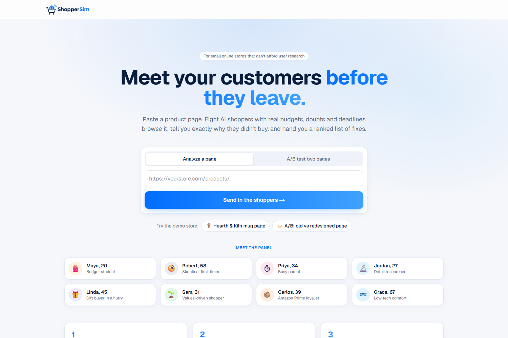
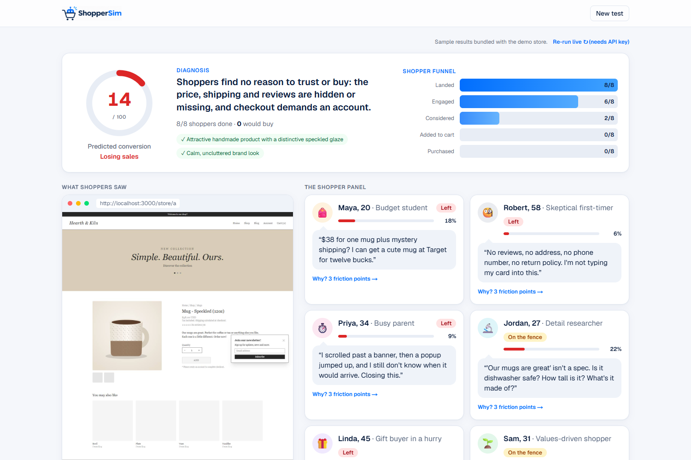
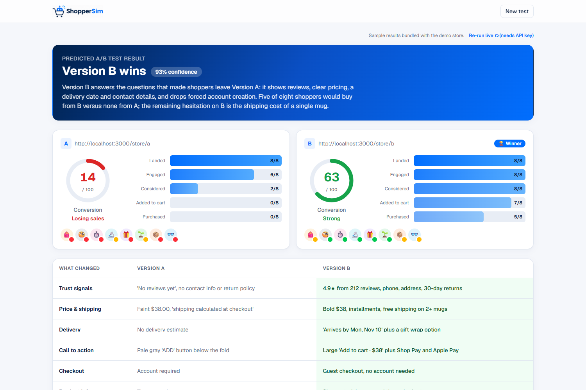
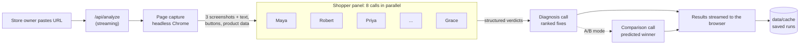
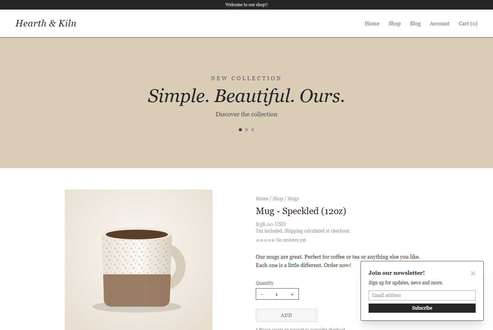
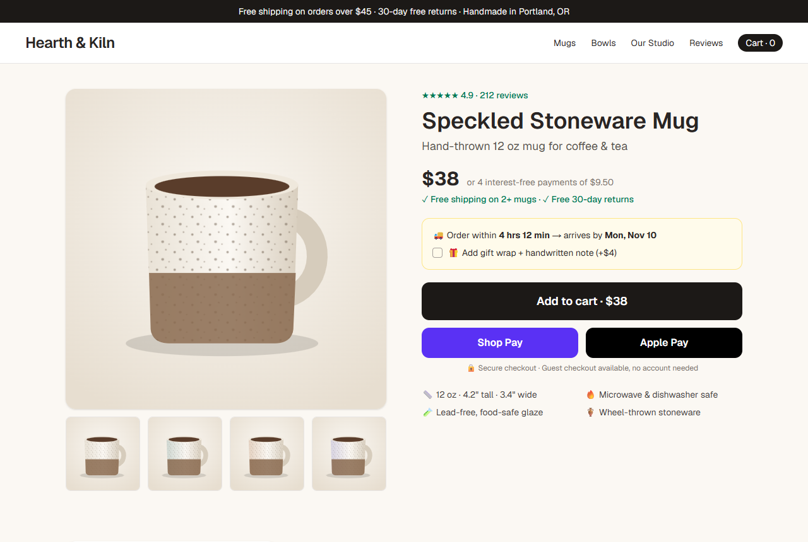

<p align="center"></p>

# ShopperSim

**Meet your customers before they leave.**

ShopperSim shows small online stores why visitors don't buy. Paste a product page URL and a panel of eight AI shoppers visits it. Each shopper has a budget, specific concerns and a deadline. They report where they hesitated and why they left, and the app turns their feedback into a ranked list of fixes with ready-to-paste copy. In A/B mode it compares two versions of a page and predicts which one would convert better.

Built for the **Viking Hacks mini-hackathon, Ecommerce track**.



---

## Contents

- [The problem](#the-problem)
- [What ShopperSim does](#what-shoppersim-does)
- [The shopper panel](#the-shopper-panel)
- [How it works](#how-it-works)
- [How the numbers are calculated](#how-the-numbers-are-calculated)
- [Demo walkthrough](#demo-walkthrough)
- [Getting started](#getting-started)
- [Project structure](#project-structure)
- [API reference](#api-reference)
- [Troubleshooting](#troubleshooting)
- [Limitations](#limitations)
- [Roadmap](#roadmap)
- [Tech stack](#tech-stack)

---

## The problem

Most visitors to an online store leave without buying. Industry estimates put cart abandonment at around 70%, and most product page visitors never add anything to a cart.

Large retailers find out why with user research studies, session recordings and A/B tests. A small business usually can't do any of that:

| What big stores use | Why small stores can't |
|---|---|
| User research and usability testing | Hundreds to thousands of dollars per study |
| A/B testing | Needs thousands of visitors per variant to reach statistical significance |
| CRO agencies | Expensive monthly retainers |
| Analytics dashboards | Show *where* people drop off, not *why* |

So most small store owners guess. They change a photo, rewrite a description and hope.

## What ShopperSim does

ShopperSim gives a small store owner a simulated focus group in about a minute, before they have the traffic or budget for real testing.

**Analyze a page.** Paste any product page URL and get:
- A **predicted conversion score** (0–100)
- A **one-sentence diagnosis** of the biggest problem
- A **shopper funnel** showing where the panel dropped off (landed, engaged, considered, added to cart, purchased)
- **Eight shopper reactions**, each with a verdict, purchase probability, quote, specific friction points and the one change that would win them over
- A **ranked action plan**: 3–6 fixes sorted by impact, labeled by effort (quick win, moderate, bigger project), with ready-to-paste copy, the shoppers each fix wins over, and an estimated score gain



**A/B test two pages.** Paste two URLs and get:
- A **predicted winner** with a confidence level and the reasoning
- A **side-by-side comparison** of score, funnel and every shopper's verdict
- A **what-changed table** showing which version handles trust, pricing clarity, calls to action and so on better
- The full breakdown for each version



<sub>Screenshots show the bundled demo-store sample results.</sub>

## The shopper panel

The eight personas cover the most common reasons real shoppers hesitate. Each one is a detailed character prompt, not a generic "act like a customer" instruction.

| | Persona | Cares about | Typical deal breaker |
|---|---|---|---|
| 🎒 | **Maya, 20**, budget student | Total price, discount codes, free shipping | Surprise costs at checkout |
| 🧐 | **Robert, 58**, skeptical first-timer | Reviews, contact info, return policy, secure checkout | No reason to trust an unknown store |
| ⏱️ | **Priya, 34**, busy parent | Seeing what, how much, when and where to click, fast | Clutter, popups, hunting for info |
| 🔬 | **Jordan, 27**, detail researcher | Specs, dimensions, materials, size guide | Vague marketing copy |
| 🎁 | **Linda, 45**, gift buyer in a hurry | Delivery date, gift options, easy returns | No delivery estimate |
| 🌱 | **Sam, 31**, values-driven shopper | Brand story, who makes it, sustainability | Generic "dropshipping" feel |
| 📦 | **Carlos, 39**, Amazon Prime loyalist | Fast free shipping, express checkout | Forced account creation, no reason not to use Amazon |
| 👓 | **Grace, 67**, low tech comfort | Readable text, simple flow, a phone number | Small text, confusing popups |

Personas live in [`src/lib/personas.ts`](src/lib/personas.ts) and are easy to edit or extend, for example with a local-market persona for a specific store's audience.

## How it works



1. **Page capture** ([`src/lib/scrape.ts`](src/lib/scrape.ts)). A headless browser opens the page at desktop size (1280×860), scrolls through it so lazy-loaded images appear, then captures up to three non-overlapping screenshots from the top of the page down. It also extracts:
   - the visible page text
   - every button and call-to-action label
   - the meta description
   - structured product data (JSON-LD price, rating and review count) when the page has it

   If no browser is available, it falls back to fetching the HTML and reading the text only.

2. **Shopper panel** ([`src/lib/claude.ts`](src/lib/claude.ts)). Each persona gets the screenshots and extracted content in a separate Claude request, all eight in parallel. The system prompt puts Claude in character and tells it to judge only what's actually on the page, citing real prices, button labels and missing information. **Structured outputs** (a Zod schema) guarantee every response has the exact shape the UI expects: verdict, probability, funnel stage, quote, friction points and the change that would win them over.

3. **Diagnosis.** A separate call acts as a conversion consultant. It reads all eight reactions plus the page and writes a headline diagnosis, the page's strengths, and 3–6 ranked fixes with concrete copy.

4. **A/B comparison** (two-URL mode only). A final call looks at both pages and both panels' results and predicts the winner, explaining the key differences.

5. **Streaming.** The API sends newline-delimited JSON events as results arrive, so each shopper's card appears as soon as that shopper finishes instead of after one long wait.

6. **Saved runs and samples** ([`src/lib/cache.ts`](src/lib/cache.ts)). Every completed run is saved to `data/cache/` and replayed with natural pacing when the same URL is tested again, so a live demo works even on unreliable Wi-Fi. When there's no saved run, the demo store falls back to the bundled samples in `data/samples/`, so it works with no API key at all. The **Re-run live** button forces a fresh analysis (if a key is configured).

## How the numbers are calculated

| Number | How it's calculated |
|---|---|
| **Purchase probability** (per shopper) | Each persona estimates its own chance (0–100%) of buying on this visit. |
| **Conversion score** (0–100) | The average of the eight purchase probabilities. It's calculated in code, not by the model, so it always matches the cards on screen. |
| **Funnel** | Each persona reports the furthest stage it reached. The bar for each stage counts how many shoppers got at least that far. |
| **Estimated gain** (per fix) | The diagnosis call estimates how many score points each fix would add. "Potential" shows the current score plus all estimated gains, capped at 100. |
| **A/B confidence** | The comparison call's confidence (50–99%) that the winner would convert better in a real A/B test. |

All of these are **predictions from simulated shoppers**, not measured conversion rates. See [Limitations](#limitations).

## Demo walkthrough

The app includes a fictional pottery shop, **Hearth & Kiln**, with two versions of the same product page:

| Version A: `/store/a` | Version B: `/store/b` |
|---|---|
|  |  |
| Typical small-shop page with common problems: a vague description, the price in faint gray text, "shipping calculated at checkout", no reviews, a low-contrast "ADD" button, forced account creation and a newsletter popup | The same product with best practices: a trust bar, reviews, a bold price with installments, free shipping and returns, a delivery date, gift wrap, a big add-to-cart button, express pay, specs, the maker's story and contact details |

Suggested demo flow (about 3 minutes):

1. **Start with the problem.** Small stores lose most of their visitors and don't know why.
2. **Click "Hearth & Kiln mug page".** The panel reacts live. Read out a couple of quotes (Robert on trust, Maya on shipping cost).
3. **Scroll to the action plan.** Point out the quick wins and the ready-to-paste copy.
4. **Click "A/B: old vs redesigned page".** Version B wins, and the what-changed table explains why.
5. **Ask a judge to name a real online store** and run it live.
6. **Close with who it's for and pricing** (for example, $19 a month per store).

> **The demo works without an API key.** Both demo buttons replay bundled sample results from `data/samples/`. The screenshots come from the real scraper, and the shopper reactions were written from what's on each demo page (see [`scripts/build-samples.mts`](scripts/build-samples.mts)). With an API key, **Re-run live** runs the real Claude panel, and that result is saved to `data/cache/` and takes priority over the sample from then on.

## Getting started

### Prerequisites

- **Node.js 20+** (developed on Node 22)
- **Google Chrome or Microsoft Edge** installed (used for screenshots)
- **An Anthropic API key** from [console.anthropic.com](https://console.anthropic.com), *only needed for analyzing new pages*. The demo store works without one.

### Try the demo (no API key)

```bash
git clone <this-repo>
cd viking-hacks
npm install
npm run dev
```

Open **http://localhost:3000** and click **Hearth & Kiln mug page** or **A/B: old vs redesigned page**.

### Analyze any store (API key)

```bash
cp .env.example .env.local
# open .env.local and set ANTHROPIC_API_KEY=sk-ant-...
npm run dev   # restart if it was already running
```

Paste any product page URL on the home page.

| | Without a key | With a key |
|---|---|---|
| Demo store, single page | ✅ Bundled sample | ✅ Sample, or live with "Re-run live" |
| Demo store, A/B test | ✅ Bundled sample | ✅ Sample, or live with "Re-run live" |
| Any other URL | ❌ Shows a message pointing to the demo | ✅ Live analysis |
| A URL you've already analyzed | ✅ Replays the saved run | ✅ Saved run, or live with "Re-run live" |

### Browser for screenshots

The app uses `playwright-core`, which doesn't download a browser. It tries the following in order:
1. Playwright's bundled Chromium, if you've installed it (`npx playwright install chromium`)
2. Your installed **Google Chrome**
3. Your installed **Microsoft Edge**
4. If none of these work: **text-only mode** (fetches the HTML; shoppers read the text without screenshots)

### Scripts

| Command | What it does |
|---|---|
| `npm run dev` | Start the development server |
| `npm run build` | Production build |
| `npm start` | Run the production build |
| `npm run lint` | Lint with ESLint |
| `npm run samples` | Rebuild the bundled demo samples (needs `npm run dev` running and Chrome or Edge) |

## Project structure

```
src/
├── app/
│   ├── page.tsx              # Main UI: landing page, live results, A/B view
│   ├── layout.tsx            # Root layout, fonts, metadata
│   ├── globals.css           # Theme tokens, cards, animations
│   ├── api/analyze/route.ts  # Streaming analysis endpoint (NDJSON)
│   └── store/                # Built-in demo store
│       ├── Mug.tsx           # SVG product illustration
│       ├── a/page.tsx        # Version A (common problems)
│       └── b/page.tsx        # Version B (best practices)
├── components/
│   └── ui.tsx                # Score gauge, funnel, persona cards, fix list, page preview
└── lib/
    ├── personas.ts           # The 8 shopper personas
    ├── scrape.ts             # Page capture (headless browser, with fetch fallback)
    ├── claude.ts             # Claude calls: persona, diagnosis, A/B comparison
    ├── cache.ts              # Saved runs for instant demo replays
    └── types.ts              # Shared types and stream event definitions
data/
├── samples/                  # Bundled demo-store results (work without an API key)
└── cache/                    # Saved live runs (created on first run, take priority over samples)
scripts/
└── build-samples.mts         # Builds data/samples from the demo store
docs/                         # README screenshots
```

## API reference

### `POST /api/analyze`

**Request body**

```json
{ "urls": ["https://store.com/products/item"], "fresh": false }
```

| Field | Type | Description |
|---|---|---|
| `urls` | `string[]` | One URL to analyze, or two for an A/B test. The `https://` prefix is optional. |
| `fresh` | `boolean` | Optional. `true` skips the saved run and analyzes again. |

**Response:** a stream of newline-delimited JSON (`application/x-ndjson`), one event per line:

| Event `type` | Payload | When it's sent |
|---|---|---|
| `status` | `side`, `message` | Progress updates ("Opening the page…") |
| `snapshot` | `side`, `snapshot` (URL, title, screenshots, text, signals) | Once the page is captured |
| `persona` | `side`, `result` (one shopper's verdict) | Eight times per side, as each shopper finishes |
| `summary` | `side`, `summary` (score, headline, strengths, fixes) | After the panel finishes |
| `compare` | `comparison` (winner, confidence, reasoning, differences) | A/B mode only, at the end |
| `error` | `message`, optional `side` | If something fails |
| `done` | `cached` (replayed rather than live), `sample` (replayed from the bundled demo samples) | Last event |

`side` is `"A"` or `"B"`. Full types are in [`src/lib/types.ts`](src/lib/types.ts).

## Troubleshooting

| Problem | Fix |
|---|---|
| "Live analysis of new pages needs an ANTHROPIC_API_KEY" | Expected without a key: use the demo store buttons, or create `.env.local` with your key and **restart** `npm run dev`. |
| Shoppers only see text, no screenshots | No browser could be launched. Install Chrome or Edge, or run `npx playwright install chromium`. |
| A site returns an error or a blank page | Some stores block automated browsers. Try a different product page, or a smaller Shopify or Etsy-style store. |
| A cookie or location popup covers the page | That's what a real first-time visitor sees, and the shoppers will often mention it. Test a page without it if you want to focus on the product content. |
| Results look outdated | Click **Re-run live** to bypass the saved run. |
| A run is slow | Eight shoppers run in parallel, so total time is roughly the slowest single shopper plus the diagnosis step, and it depends on the page and API load. Saved runs replay in a few seconds. |

## Limitations

ShopperSim is a **fast, cheap first opinion**, not a replacement for real customers.

- **Simulated, not measured.** Scores are model predictions from personas. They're useful for spotting obvious problems and comparing versions, but they aren't real conversion rates.
- **Demo samples are illustrative.** The bundled demo-store results were written to show what a run looks like without needing an API key. The app labels them "Sample results" in the UI. Use **Re-run live** with a key to see real model output for the same pages.
- **Desktop and first screens only.** The panel sees the top three screens at desktop size. It doesn't add to a cart or go through checkout.
- **Personas are general-purpose.** The eight cover common shopper concerns, not any specific store's real audience.
- **Some sites block automated browsers**, and some show region popups depending on where the server is located.
- **Cost.** Each page analysis makes 9 model calls with images, and an A/B test makes 19.

## Roadmap

- [ ] **"Fix it" mode:** apply the suggested copy and re-run the panel to show the score improving
- [ ] **Mobile view:** run the panel on phone-sized screenshots
- [ ] **Custom personas:** describe your real customers and generate a matching panel
- [ ] **Checkout flow:** follow the add-to-cart and checkout pages, not just the product page
- [ ] **Shareable PDF report** for store owners
- [ ] **Shopify app:** run a panel on every product page change automatically
- [ ] **Compare with real data:** check panel predictions against real analytics to measure accuracy

## Tech stack

| Layer | Technology |
|---|---|
| Framework | Next.js 15 (App Router), React 19, TypeScript |
| Styling | Tailwind CSS v4, custom CSS animations |
| AI | Anthropic Claude API: `claude-opus-5-5` with vision (screenshots), structured outputs (Zod schemas) and server-side refusal fallback |
| Page capture | `playwright-core` driving Chrome or Edge in headless mode |
| Streaming | Web Streams API, newline-delimited JSON |
| Storage | JSON files on disk for saved runs |

---

Built at Viking Hacks 2026.
